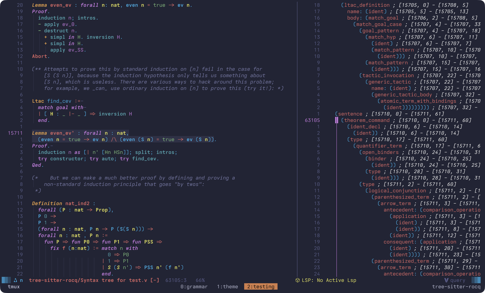

# tree-sitter-rocq

[Rocq](https://rocq-prover.org/) (formerly Coq) grammar for [tree-sitter](https://github.com/tree-sitter/tree-sitter).

The grammar is modeled around concepts from the [Software Foundations (SF) Series](https://softwarefoundations.cis.upenn.edu/).

## Usage

If you're using Neovim, you can install and configure this parser using
[nvim-tree-sitter](https://github.com/nvim-treesitter/nvim-treesitter). For other
editors, consult the
[Tree-sitter documentation](https://tree-sitter.github.io/tree-sitter).

### Highlight Groups

To see an example of the highlight groups in action, check out my personal
[Neovim configuration](https://github.com/aruzdh/.dotfiles/blob/84096d91163287632c2a639a4ff6f8c59de498d3/nvim/.config/nvim/lua/aru/plugins/ui/theme.lua).

### Beyond Syntax Highlighting

While syntax highlighting is the main focus, having a concrete CST opens up a lot
of other possibilities (like custom text-objects, code folding, and structural navigation).

If you're curious about what else you can do with a Tree-sitter parser, check out
this [Medium post](https://medium.com/@ahmedfahad04/5-powerful-ways-to-use-tree-sitter-in-your-next-project-50e17c1f7055)
for some great examples.

## Documentation

- [Motivation](docs/motivation.md) — Why this project exists.
- [Current State and Workflow](docs/current_state_and_workflow.md) — What the
  grammar covers today, and how new features get added.
- [Scope and Limitations](docs/scope_and_limitations.md) — Scope boundaries, and
  Rocq features that cap static coverage.
- [Issues and Notes](docs/issues_and_notes.md) — Where the grammar deviates
  from the reference manual, and what's still missing.

> [!NOTE]
> This project is experimental and actively evolving; breaking changes may happen
> between commits.

## References

- [Rocq Reference Manual](https://rocq-prover.org/doc/V9.2.0/refman/index.html)
  — Primary reference for language syntax.
- [Tree-sitter](https://github.com/tree-sitter/tree-sitter) — The parser generator.
- [nvim-tree-sitter](https://github.com/nvim-treesitter/nvim-treesitter/)
 — Neovim integration.

## Contributing

Everything is welcome :].
